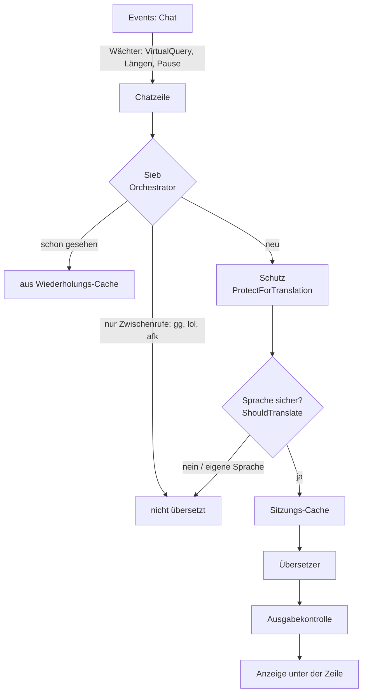

# GW2Chatlator – Logik-Karte (Stand 2.6.4, 27.10.2026)

Wozu: ein Blick auf den ganzen Weg einer Übersetzung, die Begriffslisten, die Qualitätsprüfung und die Failsafes –
damit Überschneidungen und Lücken sichtbar werden, bevor wir an die „inneren Werte“ gehen. Jede Aussage mit Datei:Zeile.

---

## 1. Eingehend: eine Chatzeile von Events: Chat bis zur Übersetzung

| # | Station | Datei | Was sie tut | Befund |
|---|---|---|---|---|
| 1 | Chatquelle | `kb_chatsource.cpp` | liest Events: Chat geschützt (VirtualQuery, Längengrenzen, SEH), pausiert bei Müll | solide |
| 2 | Sieb | `translation_orchestrator.cpp:112`, Aufruf `kb_chat.cpp:100` | Zeile nur aus Zwischenrufen → aus; Wiederholung → Cache; verdeckter Chat → später | Cache ohne Übersetzer im Schlüssel (B2) |
| 3 | Schutz | `protect.cpp:50` | schützt Chatcodes, Links, Smileys, Schutzwörter; **Glossar und Spielernamen werden mit `nullptr` übergeben** (`kb_worker.cpp:58`, `:202`) | A4 |
| 4 | Sprache + Regel | `kb_worker.cpp:75`, `translate_policy.cpp` | Windows-Spracherkennung, „sicher“-Prüfung, eigene/verstandene Sprachen aus | solide |
| 5 | Beam-Drossel | `kb_worker.cpp:100` | unter Last Beam 1 | solide |
| 6 | Sitzungs-Cache | `kb_worker.cpp:104` | Text + Quelle + Ziel + Übersetzer | doppelt zu Station 2 (B2) |
| 7 | Übersetzer | `online_translators.cpp`, `cloud_mt_protocol.cpp`, `local_mt_translator.cpp` | **drei verschiedene Schutz-Strategien** (siehe unten) | A1, A2 |
| 8 | Ausgabekontrolle | `local_mt_protocol.cpp:269`, `kb_worker.cpp:119-126` | lokal: nicht leer, ein Wort, keine erfundenen Emojis; alle: Zeichen säubern, nur zeigen wenn ≠ Original | dünn (A3) |
| 9 | Merken | `kb_worker.cpp:120` | Ergebnis in den Wiederholungs-Cache | B2 |

**Die drei Schutz-Strategien (Station 7):**

| Übersetzer | Wie geschützte Stellen behandelt werden | Folge |
|---|---|---|
| MyMemory (Standard!) | `JoinSegments` – alles zusammengeklebt und roh gesendet (`online_translators.cpp:37`) | Schutzwörter, Namen, Codes ungeschützt (A2) |
| Google, Microsoft, DeepL | ganzer Satz, geschützte Stellen als `` (`cloud_mt_protocol.cpp:17`) | richtig: Kontext bleibt, Schutz hält |
| OPUS-MT, NLLB (lokal) | Satz an jeder Schutzstelle **zerschnitten**, Stücke einzeln übersetzt (`local_mt_translator.cpp:88-119`) | Kontext geht verloren; mehrere Sätze am Stück → NLLB lässt Sätze weg (A1) |

## 2. Ausgehend: dein Text bis in den GW2-Chat

`kb_worker.cpp:179` TranslateInput → eigene Wörter einsetzen (`my_words`) → Schutz → Sprache erkennen → übersetzen →
Rückübersetzung (`:238`) → Vorschau → **bei Fehler wird nichts gesendet**, der Text kommt zurück (`:267`) → in Chatzeilen
teilen → Sende-Wächter (`send_guard.hpp`: echte Taste, selbst getippt, keine Wiederholung, Rate, Sperre).

Befund: der Sende-Wächter schützt vor Missbrauch (Invariante 1), aber **keine Prüfung, ob die Übersetzung vollständig ist**
– die Rückübersetzung wird angezeigt, nicht ausgewertet (A3).

## 3. Begriffslisten – wo sie leben

| Liste | Datei | Wirkung | Befund |
|---|---|---|---|
| Zwischenrufe (gg, lol, afk, wtf, hi …) | `translation_orchestrator.cpp:12` | Zeile **nur** aus solchen Wörtern → nicht übersetzt | „wtf“ steht nur hier: im Satz („wtf is this“) wird es übersetzt (B1) |
| Schutzwörter (lfg, wvw, dps, necro …) | `slang.cpp:16` | nie übersetzt, auch im Satz | Quelle: GW2-Wiki-Abkürzungsliste, von Hand gewählt |
| Schutzwörter nur in Großbuchstaben (LA, HoT, DS …) | `slang.cpp:38` | „DS“ geschützt, „ds“ nicht | löste den [DS]-Fall aus (A1) |
| Nur Rechtschreibung (raid, loot, buff …) | `slang.cpp:44` | nie rot unterstrichen, aber übersetzbar | ok |
| Startwörter | `slang.cpp:61` | Wortleiste am Anfang | ok |
| Glossar offizieller Namen (GW2-API) | `glossary.hpp` | „Löwenstein“ → „Lion's Arch“ | **gebaut und getestet, nicht angeschlossen** (A4) |
| Spielernamen | `names.hpp` | Namen im Satz unverändert | **nicht angeschlossen** (A4) |
| Eigene Wörter | `my_words.hpp` | dein Kürzel → Bedeutung, nur für den Übersetzer | ok |

Überschneidung: „wp“ heißt im Sieb „well played“, in den Schutzwörtern „Waypoint“ – zwei Listen, zwei Bedeutungen (B1).

## 4. Bekommen wir Qualitäts-Feedback von den Modellen?

| Quelle | Feedback | Stand |
|---|---|---|
| OPUS-MT / NLLB (CTranslate2) | **ja**: `return_scores` liefert pro Übersetzung die mittlere Log-Wahrscheinlichkeit = wie sicher das Modell war | nicht abgefragt (`translate_helper_main.cpp:191`, `:234`) |
| MyMemory | `match`-Wert im JSON; mit `mt=1` (reine Maschinenübersetzung) wenig aussagekräftig | nicht gelesen |
| DeepL, Google, Microsoft | keine Konfidenz | – |
| eigene Prüfungen (für alle) | Abdeckung (Satzzahl, Längenverhältnis), Schutzstellen erhalten, Ergebnissprache = Ziel, Rückübersetzung | fehlen (A3) |

Wie bei RapidOCR die Erkennungs-Sicherheit: der Score der lokalen Modelle plus unsere eigenen Prüfungen ergeben eine
Qualitätszahl je Zeile – unsichere Zeilen können wir markieren statt still falsch zu zeigen.

## 5. Failsafe und Fallbacks

| Was | Datei | Verhalten | Befund |
|---|---|---|---|
| Jeder Nexus-Aufruf | `kb_main.cpp:132-166` | SEH + C++-Netz → Add-on schaltet sich für die Sitzung ab, Spiel läuft | **still**: nur `nexus.log`, der Nutzer sieht das Add-on einfach verschwinden (C1) |
| Start | `kb_main.cpp:187` | Nexus-API geprüft (`IsCodePointer`), sonst aus | ok |
| Chatquelle | `kb_chatsource.cpp` | pausiert bei Müll, „Fortsetzen“ | ok |
| Übersetzer | `kb_state.cpp:329`, `kb_window.cpp:563` | harter Fehler → MyMemory für die Sitzung (ein Klick) | ok |
| Voice | `kb_voice.cpp:50` | zweimal zu langsam → kleineres Modell | ok |
| Downloads | `local_mt_packages.cpp:186`, `voice_module.cpp:92` | extras → Versions-Tag → latest | ok |
| Schrift | `kb_shared.hpp:210` | ohne Nexus-Schriftfunktionen ImGui-Standard | ok |
| Helfer | 2.6.3 | Handshake, Update auf Klick, Rollback | ok |

Einen Betrieb **ohne** Nexus gibt es nicht – Nexus ist der Host; fällt es aus, lädt das Add-on nicht. Was es gibt: jede
Nexus-Funktion wird vor Gebrauch geprüft, fehlende werden umgangen (Schrift, Events).

---

## 6. Befunde – Lücken und Überschneidungen

**A – betrifft die Übersetzungsqualität direkt**

- **A1 – Text geht verloren (der [DS]-Fall).** „DS“ ist ein Schutzwort (`slang.cpp:39`), die lokale Übersetzung zerschneidet
  den Satz dort, das letzte Stück (ab „]“ bis zum Ende) enthält drei Sätze, NLLB übersetzt nur einen.
  Abhilfe: Klammer-Tags wie `[DS]` als Ganzes schützen; für lokale Modelle **satzweise** übersetzen; nicht mehr an jeder
  Schutzstelle zerschneiden, sondern den ganzen Satz senden und danach prüfen, ob die Schutzwörter erhalten sind.
- **A2 – MyMemory ohne Schutz.** Der Standard-Übersetzer bekommt Schutzwörter, Namen und Codes roh.
- **A3 – Ausgabekontrolle dünn und je Übersetzer verschieden.** Eine gemeinsame Prüfung nach jedem Übersetzer:
  Schutzstellen vollständig, Abdeckung (Satzzahl, Länge), Ergebnis in der Zielsprache, nicht gleich der Quelle; ausgehend
  die Rückübersetzung als Prüfwert nutzen. Fällt eine Prüfung durch: satzweise neu versuchen oder als unsicher markieren.
- **A4 – Glossar und Spielernamen gebaut, nicht angeschlossen.** Offizielle Namen (Karten, Berufe, Reittiere) würden exakt
  übersetzt; Namen im Satz blieben unberührt.

**B – Überschneidungen**

- **B1 – drei Begriffslisten** (Zwischenrufe, Schutzwörter, Rechtschreibung) mit Doppelungen und Widersprüchen („wp“,
  „wtf“). Eine Begriffstabelle mit Kategorien je Begriff.
- **B2 – zwei Caches.** Der Wiederholungs-Cache kennt den Übersetzer nicht: nach einem Wechsel kann das Sieb die
  Übersetzung des alten Übersetzers zeigen.
- **B3 – Modell-Score ungenutzt** (Abschnitt 4).

**C – Robustheit und Pflege**

- **C1 – stilles Abschalten.** Nach einem Fehler eine einzige, abgesicherte Zeile: „GW2Chatlator hat sich nach einem
  Fehler abgeschaltet – Details in nexus.log, GW2 neu starten“.
- **C2 – GW2-Wiki-Begriffe neu abgleichen.** Die Schutzwörter stammen aus der Abkürzungsliste des Wikis. Vor einer
  größeren Übernahme die Lizenz der Seite prüfen (das Wiki steht unter CC BY-NC-SA); einzelne, von Hand geprüfte
  Abkürzungen wie bisher sind unkritisch.

## 7. Vorschlag für die Reihenfolge

1. **Messbar machen:** eine feste Testsammlung echter Chatzeilen (der [DS]-Satz als erster Fall, Spielbegriffe, Namen,
   Codes, mehrere Sätze) und ein `translation_bench` wie `typing_bench`: Schutzstellen erhalten %, Abdeckung %, Sätze
   verloren. Erst messen, dann ändern – keine Kaskade von Annäherungen.
2. **A1 + A3:** satzweise lokal, Klammer-Tags, gemeinsame Ausgabekontrolle mit Abdeckungsprüfung.
3. **A2:** MyMemory bekommt denselben Schutz.
4. **B3:** Score aus dem Helfer (optionales Feld `score` in `result`, Fähigkeit `score` im Handshake; ältere DLLs lesen es
   nicht und laufen weiter).
5. **A4:** Glossar und Spielernamen anschließen.
6. **B1, B2:** eine Begriffstabelle, ein Cache.
7. **C1, C2.** RapidOCR bleibt für das Ende geplant.
